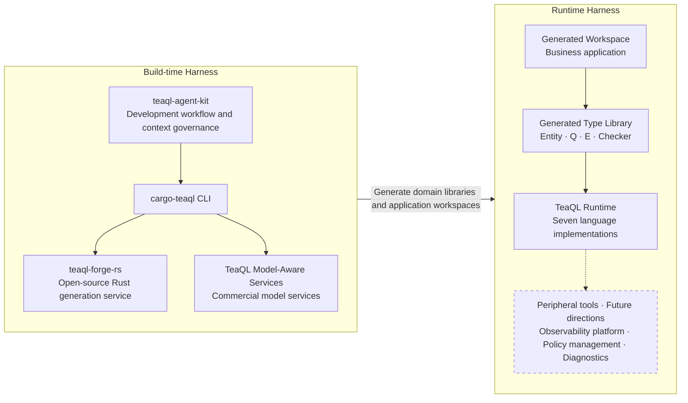

# TeaQL

**A runtime harness for AI-built business applications.**

TeaQL connects a business model, generated domain APIs, and reusable runtimes.
Its build-time tools help developers and AI agents evaluate models, discover
APIs, and generate application foundations. Its runtime harness carries those
contracts into application execution through typed requests, validation,
trusted context, policy, transactions, and audit.

[Start with an AI agent](https://github.com/teaql/teaql-agent-kit#start-with-a-prompt)
· [Documentation](https://teaql.io)
· [中文](README.zh-CN.md)

## Design goals

- **Keep business meaning explicit.** Use a shared domain model to describe
  entities, relationships, and validation, then generate APIs around that
  vocabulary.
- **Make capabilities discoverable.** Give agents model-aware evaluation and
  progressive Assist for the entities and operations they are working on.
- **Carry rules into execution.** Apply validation, query intent, mutation audit,
  and application-installed policies at the relevant TeaQL execution boundaries.
- **Support change and verification.** Regenerate domain libraries as models
  evolve, keep application code in its own workspace, and verify behavior
  against explicit language, provider, and version combinations.

## Build-time Harness and Runtime Harness

**Build-time Harness** runs in the development environment. Agent Kit supplies
the workflow and agent integrations; the CLI connects it to model services.
Developers can also use the CLI independently. The open-source Forge service
focuses on Rust. Commercial **TeaQL Agentic Model-Aware Services** provide
model evaluation, seven-language domain-library generation, target-specific
workspaces, and progressive Assist. Their feature sets are documented
separately.

**Runtime Harness** is the application's execution foundation. The Workspace
hosts business code and assembles its dependencies. The generated Type Library
provides model-specific entities, Q queries, E expressions, and Checker rules.
The selected language Runtime executes supported operations through the
application's configured context and providers. Type Library and Workspace are
build-time outputs that become parts of the running application; application
code stays editable, and domain-library changes come from the model and
regeneration.

## Projects

| Project | Role |
| --- | --- |
| [teaql-agent-kit](https://github.com/teaql/teaql-agent-kit) | Build TeaQL App Skill, Agent Context Kit, and host integrations. Enforcement depends on the adapter and entry point. |
| [teaql-cargo-cli](https://github.com/teaql/teaql-cargo-cli) | The `cargo-teaql` client for model-service discovery, evaluation, generation, and Assist. |
| [teaql-forge-rs](https://github.com/teaql/teaql-forge-rs) | A local-first, open-source Rust generation service. |
| TeaQL Agentic Model-Aware Services | Commercial model-intelligence services, including generation and API guidance. |

The seven Runtime implementations share an architectural contract and retain
their own language APIs, providers, releases, and verification boundaries:

| Language | Runtime repository |
| --- | --- |
| Java | [teaql-java](https://github.com/teaql/teaql-java) |
| Rust | [teaql-rs](https://github.com/teaql/teaql-rs) |
| TypeScript | [teaql-ts](https://github.com/teaql/teaql-ts) |
| Go | [teaql-golang](https://github.com/teaql/teaql-golang) |
| Python | [teaql-python](https://github.com/teaql/teaql-python) |
| .NET | [teaql-dotnet](https://github.com/teaql/teaql-dotnet) |
| Swift | [teaql-swift](https://github.com/teaql/teaql-swift) |

## Current status and future directions

The Agent Kit, CLI, open-source Forge, commercial model services, and seven
Runtime implementations form the current project landscape. Generated
workspaces depend on the selected target; Swift currently has domain-library
generation without a separate application-workspace target.

Runtime telemetry, execution traces, structured logs, and audit already provide
a foundation for inspecting application behavior. Independent observability
products, policy-management tools, and operational diagnostics are future
directions shown with a dashed border in the diagram. Audit and telemetry
retain separate responsibilities. See
[Debugging, Audit, and Observability](https://teaql.io/docs/core/core-concepts/debugging-observability/)
for the existing runtime facilities.

Published packages, generator-selected versions, and verified application
scenarios have separate status. Use [Latest Versions](https://teaql.io/docs/reference/latest-versions/)
and the [language guides](https://teaql.io/docs/languages/overview/) to choose a
starting point. Cross-language conformance checks, retained scenario evidence,
and performance experiments support verification; each result applies to its
recorded scope.

## Build your first application

Start with [TeaQL Agent Kit](https://github.com/teaql/teaql-agent-kit#start-with-a-prompt).
Describe a small business application and choose a language and database.
Follow the model → evaluate → generate → implement → verify workflow, then
inspect the application's actual build, query, and audited mutation results.
