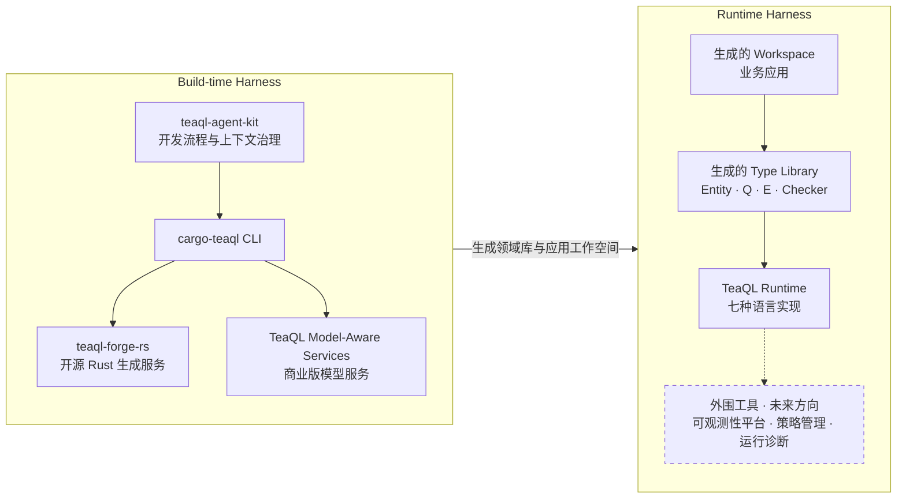

# TeaQL

**面向 AI 构建的业务应用，提供运行时 Harness。**

TeaQL 将业务模型、生成的领域 API 与可复用的 Runtime 连接起来。开发时，
工具与服务帮助开发者和 AI Agent 评估模型、发现 API 并生成应用基础；运行时，
类型化请求、校验、可信上下文、策略、事务和审计机制继续落实这些契约。

[通过 AI Agent 开始](https://github.com/teaql/teaql-agent-kit#start-with-a-prompt)
· [官方文档](https://teaql.io)
· [English](README.md)

## 设计目标

- **明确业务语义。** 用共享领域模型描述实体、关系和校验要求，围绕同一套业务词汇生成 API。
- **让能力可发现。** 通过模型评估和渐进式 Assist，提供当前实体与操作所需的准确指导。
- **把规则落实到执行。** 在相应的 TeaQL 执行入口检查校验规则、查询意图、变更审计，以及应用安装的策略。
- **支持演进与验证。** 模型变更后重新生成领域库，业务代码保留在独立的 Workspace 中，并针对明确的语言、Provider 和版本组合验证行为。

## Build-time Harness 与 Runtime Harness

**Build-time Harness** 是在开发环境中使用的工具与服务。Agent Kit 提供开发流程
和 Agent 集成，CLI 连接模型服务，也可以独立使用。开源 Forge 服务面向 Rust；
商业版 **TeaQL Agentic Model-Aware Services** 提供模型评估、七语言领域库生成、
依目标提供的 Workspace，以及渐进式 Assist。两者各自说明其能力范围。

**Runtime Harness** 是应用的执行基础。Workspace 承载业务代码并组装依赖；生成的
Type Library 提供模型对应的实体、Q 查询、E 表达式和 Checker 规则；所选语言的
Runtime 通过应用配置的上下文与 Provider 执行其支持的操作。Type Library 和
Workspace 由开发阶段生成，并成为运行中应用的组成部分。业务代码保持可编辑，
领域库通过修改模型和重新生成来演进。

## 项目入口

| 项目 | 职责 |
| --- | --- |
| [teaql-agent-kit](https://github.com/teaql/teaql-agent-kit) | Build TeaQL App Skill、Agent Context Kit 与宿主集成；实际约束能力依适配器和入口而定。 |
| [teaql-cargo-cli](https://github.com/teaql/teaql-cargo-cli) | `cargo-teaql` 客户端，用于模型服务发现、评估、生成和 Assist。 |
| [teaql-forge-rs](https://github.com/teaql/teaql-forge-rs) | 可在本地运行的开源 Rust 生成服务。 |
| TeaQL Agentic Model-Aware Services | 商业版模型感知服务，提供代码生成和 API 指导等能力。 |

七种语言 Runtime 共享架构契约，各自维护语言 API、Provider、版本和验证范围：

| 语言 | Runtime 仓库 |
| --- | --- |
| Java | [teaql-java](https://github.com/teaql/teaql-java) |
| Rust | [teaql-rs](https://github.com/teaql/teaql-rs) |
| TypeScript | [teaql-ts](https://github.com/teaql/teaql-ts) |
| Go | [teaql-golang](https://github.com/teaql/teaql-golang) |
| Python | [teaql-python](https://github.com/teaql/teaql-python) |
| .NET | [teaql-dotnet](https://github.com/teaql/teaql-dotnet) |
| Swift | [teaql-swift](https://github.com/teaql/teaql-swift) |

## 当前状态与未来方向

当前项目包括 Agent Kit、CLI、开源 Forge、商业版模型服务，以及七种语言 Runtime。
生成的 Workspace 依目标而定；Swift 目前提供领域库生成，没有单独的应用 Workspace 目标。

Runtime 已有遥测、执行路径、结构化日志和审计基础，用于检查应用行为。
独立可观测性产品、策略管理工具和运维诊断工具属于未来方向，在图中以虚线边框标注。
审计与遥测分别承担业务责任记录和运行信号采集的职责。已有能力见
[调试、审计与可观测性](https://teaql.io/docs/core/core-concepts/debugging-observability/)。

包已发布、生成服务选用的版本、具体应用场景验证通过，分别表示不同状态。
请结合[最新版本](https://teaql.io/docs/reference/latest-versions/)和
[语言指南](https://teaql.io/docs/languages/overview/)选择起点。
跨语言一致性检查、保留的场景证据和性能实验为验证提供支撑，各项结果以其记录的范围为准。

## 构建第一个应用

从 [TeaQL Agent Kit](https://github.com/teaql/teaql-agent-kit#start-with-a-prompt) 开始，
描述一个小型业务应用，选择语言与数据库，完成“建模 → 评估 → 生成 → 实现 → 验证”流程，
再查看应用真实的构建、查询和带审计的数据变更结果。
